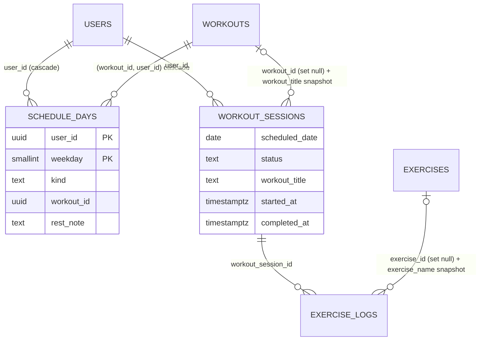

# Plano técnico: Agenda semanal

**Spec**: [spec.md](spec.md) (49 RFs, aprovada) | **ADR**: [0002](../../adr/0002-sessao-conta-para-o-dia-da-agenda.md) | **Criado em**: 2026-10-17
**Issues**: [issues/](issues/) (F2.01 a F2.20)

## Resumo técnico

A fase troca o rodízio de fichas por uma agenda de sete dias por aluno e liga cada sessão de treino a um dia da agenda, fixado no servidor no momento do início. Entregáveis de engenharia:

1. **Schema versionado** em `supabase/migrations/`, começando por um baseline gerado do banco atual (`supabase db pull`) e seguido pelas migrations desta fase: tabela `schedule_days`, colunas novas em `workout_sessions` (dia ligado, status, snapshot do título), snapshot do nome em `exercise_logs`, FKs com `ON DELETE` explícito e `anamnesis.training_days`.
2. **Domínio puro** em `src/core/domain/schedule/`, sem framework, testado com Vitest (configurado na Fase 1): semana e dia em Brasília, treino do dia, status do dia, o que pode ser iniciado, reposição, retomada de sessão, distribuição da migração com ordenação natural e distribuição dos rascunhos da IA.
3. **Aplicação e infraestrutura** no padrão já usado em notificações: interfaces de repositório em `src/core/application/interfaces/`, use cases em `src/core/application/use-cases/`, implementação Supabase em `src/infrastructure/repositories/`.
4. **Server actions finas** em dois arquivos novos (`src/app/admin/agenda/actions.ts` e `src/app/aluno/agenda/actions.ts`), com Zod na fronteira e checagem de posse em toda leitura e escrita.
5. **Sessão iniciada no servidor**: `startWorkoutSession` cria a linha com `started_at = now()` e `scheduled_date` validados pelo servidor; `finishWorkoutSession` passa a ser idempotente por `session_id` (função SQL em transação). Isso resolve também o RF-025 da Fase 3 ("tentar de novo não cria uma segunda sessão").
6. **UI no visual atual**: aba Agenda no perfil do aluno, home e aba Treinos do aluno reescritas sobre a visão da semana, sessão de treino com botão de início e retomada segura.
7. **Migração de dados única**, por script versionado e idempotente, ensaiada no projeto Supabase de desenvolvimento e executada na entrega logo após segunda 00:00 em Brasília, com runbook de backup, aplicação, verificação, deploy e rollback.

## Contexto técnico

| Item | Estado hoje (CODEBASE_MAP) | Impacto nesta fase |
|---|---|---|
| Schema | Não versionado; mudanças feitas no dashboard. FKs e políticas de `workout_sessions`, `exercise_logs` e `exercises` desconhecidas | F2.01 cria o baseline antes de qualquer migration; os nomes de constraints usados nas migrations desta fase vêm do baseline |
| Acesso ao banco | Server actions usam o cliente service role (`createAdminClient`), que não aplica RLS | Posse checada em todo use case; tabelas novas com RLS habilitado e sem grants para `anon`/`authenticated` |
| Sessão de treino | `finishWorkoutSession` insere a sessão no fim; estado em `localStorage` por ficha (`hammer_session_<workoutId>`) | Início passa ao servidor, com `started_at` gravado pelo servidor; o registro local ganha `sessionId` e `scheduledDate`; entradas legadas tratadas pelo RF-049 |
| Semana | `getWeekStart()` usa o relógio do servidor (UTC na Vercel) | Toda regra de semana e dia sai do domínio, em `America/Sao_Paulo` |
| Clean Architecture | Só notificações e push em `src/core` + `src/infrastructure`; sem composition root (instanciação na action) | Mesmo padrão: repositório por interface, implementação Supabase, instanciação na action |
| Testes | Sem framework; a Fase 1 configura o Vitest (F1.01) | Todas as issues de domínio dependem de F1.01 |
| Anamnese | `days_per_week` inteiro, opcional; funil oferece 3 a 6 | Coluna nova `training_days smallint[]`; o legado é mantido e o número passa a ser derivado |
| Exclusão de ficha | `deleteWorkout` apaga exercícios e a ficha; efeito nas sessões depende de FK não versionada; `updateWorkoutWithExercises` já apaga e recria exercícios (gotcha 15) | FKs explícitas com `ON DELETE SET NULL` + snapshots de título e nome |

Versões (package.json): Next 16.2.6, React 19.2.4, `@supabase/ssr` 0.10, `supabase-js` 2.106, Zod 4.4, TypeScript 5, `@types/node` 20. Docs confirmadas no Context7 em 2026-10-17: Supabase CLI (`link`, `db pull`, `db dump`, `db push`, `migration new`, `migration list`, `migration repair`), Postgres 17 (`AT TIME ZONE`, `date_trunc(..., zone)`, índice único parcial, `ON DELETE SET NULL`, collations ICU), Supabase (service role faz `bypassrls`; grants e RLS por tabela), Next 16 (`revalidatePath`, `refresh` em server action), Vitest (`vi.useFakeTimers`/`vi.setSystemTime`, `process.env.TZ` no config).

## Arquitetura e camadas

### Agregado e invariantes

**Agregado `StudentWeeklySchedule` (Agenda semanal do aluno)**. Raiz: o aluno (`studentId`). Filhos: exatamente sete `ScheduleDay` (segunda a domingo). Pergunta que define a fronteira: "o que precisa ser verdade de uma vez só?" A agenda inteira, porque salvar é substituir os sete dias de uma vez e a regra "a mesma ficha pode estar em vários dias, mas cada dia aponta para no máximo uma ficha" só é verificável olhando os sete.

Invariantes do agregado (verdadeiras ao fim de toda operação):

1. Sete dias, um por dia da semana (1 = segunda ... 7 = domingo), sem repetição nem falta. No banco, dia livre é ausência de linha; no domínio, o objeto sempre materializa os sete.
2. Cada dia é exatamente um de: `workout` (com `workoutId`), `rest` (com `restNote` opcional de até 500 caracteres) ou `free`.
3. A ficha apontada pertence ao mesmo aluno (no banco: FK composta `(workout_id, user_id)`).
4. A agenda não conhece status de execução; status é read model derivado de sessões.

**Agregado `WorkoutSession` (Sessão de treino)**. Separado da agenda, referenciado por valor (`studentId`, `scheduledDate`), nunca por objeto. Invariantes:

1. Pertence a um aluno e a uma ficha; guarda o snapshot do título da ficha.
2. `scheduledDate` é fixado na criação e só pode ser hoje ou um dia passado da semana corrente em Brasília; nunca o futuro, nunca fora da semana. Pode ser nulo (ficha avulsa, sessão legada, finalização sem dia).
3. No máximo uma sessão não descartada por (aluno, dia). Enforced por índice único parcial.
4. Transições: `in_progress -> completed`, `in_progress -> discarded`. Finalizar uma sessão já finalizada é no-op com sucesso (idempotência).

**Read model `WeekView`**: os sete dias da semana corrente com data, conteúdo visível ao aluno, status derivado e a ficha executada quando há sessão. Calculado por função pura a partir de agenda + fichas + sessões da semana + hoje.

### Camadas

```
src/core/domain/schedule/            # funções puras, zero import de framework
  brasilia-time.ts                   # toBrasiliaDate, weekBoundsOf, weekdayOf, brasiliaMidnightInstant
  schedule.ts                        # tipos ScheduleDay/WeeklySchedule, materialize, isPublishedStatus
  week-view.ts                       # buildWeekView, deriveDayStatus, resolveHome, listStandaloneWorkouts
  session-rules.ts                   # evaluateSessionStart, classifyResumedSession, resolveLegacySessionDay
  migration-distribution.ts          # distributeWorkoutsForMigration, naturalTitleComparator
  ai-draft-distribution.ts           # assignDraftsToAvailableDays
  *.test.ts                          # Vitest, ao lado de cada módulo
src/core/application/interfaces/
  schedule.repository.ts             # IScheduleRepository
  workout-session.repository.ts      # IWorkoutSessionRepository
src/core/application/use-cases/
  get-student-week.use-case.ts
  save-student-schedule.use-case.ts
  start-workout-session.use-case.ts
  finish-workout-session.use-case.ts
  adopt-legacy-local-session.use-case.ts
  assign-ai-drafts-to-schedule.use-case.ts
src/infrastructure/repositories/
  supabase-schedule.repository.ts
  supabase-workout-session.repository.ts
src/app/admin/agenda/actions.ts      # professor: ler e salvar agenda, uso de ficha na agenda
src/app/aluno/agenda/actions.ts      # aluno: home, semana, dia, iniciar, finalizar, descartar, adotar legado
src/lib/auth.ts                      # getAuthUser e requireAuth movidos de actions.ts (sem mudar comportamento)
tools/migrate-schedules.ts           # migração de dados única, usa distributeWorkoutsForMigration
supabase/migrations/                 # baseline + migrations desta fase
```

A dependência aponta para dentro: `domain` não importa nada; `application` importa `domain` e define as interfaces; `infrastructure` implementa as interfaces com `createAdminClient`; as actions instanciam repositório e use case (como `SendNotificationUseCase` hoje) e só validam entrada, autenticam e mapeiam o resultado.

### Fluxo de iniciar e finalizar a sessão

```mermaid
sequenceDiagram
    participant A as Aluno (browser)
    participant WS as WorkoutSession (client)
    participant LS as localStorage
    participant SA as aluno/agenda/actions.ts
    participant UC as Start/Finish use cases
    participant D as core/domain/schedule
    participant R as SupabaseWorkoutSessionRepository
    participant DB as Postgres

    A->>SA: abre /aluno/treino/[id]?dia=2026-10-20
    SA->>UC: getScheduleDayView(userId, workoutId, dia)
    UC->>D: toBrasiliaDate(now), buildWeekView(...)
    UC-->>SA: mode: startable | readonly_future | completed | resume(sessionId)
    SA-->>WS: view + sessão em andamento (se houver)
    WS->>LS: loadSessionById(sessionId) ou detecta entrada legada por workoutId

    A->>WS: toca "Iniciar treino"
    WS->>SA: startWorkoutSession({ workoutId, scheduledDate })
    SA->>UC: execute(userId, input)
    UC->>R: carregar agenda, ficha, sessões da semana
    UC->>D: evaluateSessionStart({ today, weekStart, day, workout, existing })
    alt recusado (futuro, dia livre, rascunho, ficha de outro dia, outro aluno)
        UC-->>SA: { success: false, reason }
    else permitido
        UC->>R: insertInProgress({ userId, workoutId, workoutTitle, scheduledDate, startedAt: now() })
        R->>DB: INSERT workout_sessions (status in_progress)
        DB-->>R: id, ou 23505 (já existe para o dia)
        R->>DB: em 23505, SELECT a sessão in_progress do dia e devolve (resume)
        UC-->>SA: { sessionId, scheduledDate, startedAt }
    end
    SA-->>WS: sessionId
    WS->>LS: saveSession({ sessionId, workoutId, scheduledDate, ... })

    loop cada série
        A->>WS: carga + marcar série
        WS->>LS: saveSession
    end

    A->>WS: Finalizar
    WS->>SA: finishWorkoutSession({ sessionId, logs, detachDay? })
    SA->>UC: execute(userId, input)
    UC->>R: finish(sessionId, userId, logs, detachDay)
    R->>DB: SELECT finish_workout_session(...) em transação
    Note over DB: posse + status; insere logs; completed_at = now(); já concluída = no-op
    DB-->>R: { status, scheduled_date }
    UC-->>SA: { success: true, scheduledDate }
    SA-->>WS: ok
    WS->>LS: clearSession(sessionId)
```

Pontos do fluxo que respondem a RFs:

- O servidor fixa `started_at` e valida `scheduled_date` no início (RF-008, RF-009, RF-019, RF-020). O cliente nunca envia `startedAt`.
- A finalização aceita qualquer momento posterior, inclusive depois da meia-noite e da virada da semana (RF-009), porque só depende do `session_id` e do status.
- Uma segunda tentativa de finalizar após timeout devolve sucesso sem duplicar (idempotência por `session_id` na função SQL). Isso atende ao RF-025 da Fase 3; a Fase 3 só precisa tratar a UI de erro e o botão.
- O professor pode trocar a ficha do dia durante a sessão: a sessão já guarda `workout_id` e `workout_title`, então o dia fica feito com a ficha iniciada (RF-021).
- Sessão retomada: `getScheduleDayView` devolve a sessão `in_progress` do servidor; o domínio classifica como `continue` (semana do dia ligado ainda é a corrente) ou `week_ended` (RF-022), e o cliente oferece finalizar sem dia (`detachDay: true`) ou descartar (`discardWorkoutSession`).
- Registro local anterior à entrega (sem `sessionId`): o cliente detecta a chave legada `hammer_session_<workoutId>` e chama `adoptLegacyLocalSession`, que aplica o RF-049 no servidor e devolve um `sessionId`; a partir daí o fluxo é o normal.

## Decisões com trade-offs

| # | Decisão | Alternativa descartada | Por quê |
|---|---|---|---|
| D1 | Dia livre é ausência de linha em `schedule_days`; só `workout` e `rest` têm linha | Sete linhas sempre, com `kind = 'free'` | Menos linhas, `ON DELETE CASCADE` da ficha transforma o dia em livre sem trigger (RF-014), e "agenda existente" (RF-048) vira `EXISTS (linha do aluno)`. O domínio materializa os sete dias, então a invariante de sete dias vive no agregado |
| D2 | Sessão criada no servidor no início, com status `in_progress` | Continuar criando só no fim e enviar `startedAt` do cliente | RF-019 exige início do servidor; cria também o `session_id` que torna a finalização idempotente (RF-023 e RF-025 da Fase 3) |
| D3 | Índice único parcial `(user_id, scheduled_date) WHERE scheduled_date IS NOT NULL AND status <> 'discarded'` | Checagem só no use case | Garante RF-023 sob concorrência (duas abas, dois toques). O use case trata o 23505 como "retomar a sessão em andamento do dia" |
| D4 | `finish_workout_session` como função SQL em transação | Duas chamadas PostgREST (update + insert) | Hoje a falha dos logs apaga a sessão órfã; com a sessão criada no início isso não serve mais. A função dá atomicidade e idempotência em uma chamada; é a única operação multi-tabela da fase |
| D5 | `set_schedule_days` como função SQL (delete + insert em transação) | Upsert dos dias preenchidos + delete dos livres em duas chamadas | Uma falha parcial deixaria um dia antigo na agenda sem o professor saber. A função é pequena e o custo de versioná-la já está pago pelo baseline |
| D6 | Snapshots: `workout_sessions.workout_title` e `exercise_logs.exercise_name`, com FKs `ON DELETE SET NULL` | Soft delete de fichas (`deleted_at`) | Soft delete espalharia filtros por todas as queries de `workouts`. O snapshot resolve RF-013, RF-014 e RF-016 e também o gotcha 15 (exercícios recriados na edição) |
| D7 | Regras de dia e semana em TypeScript puro com `Intl.DateTimeFormat` (`timeZone: 'America/Sao_Paulo'`); SQL só usa fuso em consultas de histórico via instante calculado no domínio | Coluna gerada `started_on_brasilia` | Coluna gerada exige expressão `IMMUTABLE`; `AT TIME ZONE` com zona nomeada é `STABLE` (depende de tzdata). O domínio calcula o instante UTC de "segunda 00:00 em Brasília" e a query filtra `started_at >= instante`. Sem offset fixo: segue o tzdata (caso de borda do horário de verão) |
| D8 | Migração de dados por script TypeScript versionado (`tools/migrate-schedules.ts`) que reusa `distributeWorkoutsForMigration` | Migration SQL com collation ICU (`und-u-kn-ks-level1`) | Uma única implementação da ordenação natural, testada no Vitest com os cenários 3.7 e 3.8 da spec. O script é idempotente (pula alunos com linha em `schedule_days`) e tem `--dry-run`. Custo: devDependency `tsx` (aprovação do Mauri) e rodar à mão na entrega. A alternativa SQL fica registrada caso o `tsx` seja vetado |
| D9 | Actions novas em dois arquivos próprios; `getAuthUser`/`requireAuth` movidos para `src/lib/auth.ts` | Acrescentar tudo ao `actions.ts` de 2.838 linhas, ou copiar os helpers pela quarta vez | O padrão de arquivo por domínio já existe (`admin/ia/actions.ts`). Mover os dois helpers é a menor mudança que evita a cópia; comportamento idêntico |
| D10 | Botão explícito "Iniciar treino" na página da sessão | Iniciar ao abrir a página | Abrir não pode criar sessão (dia futuro abre em leitura, RF-029; abrir e sair criaria sessões vazias). O botão é o momento do início que o RF-008 exige e segue o visual atual |
| D11 | Divergência da IA registrada no `ai_notes` dos rascunhos | Coluna nova | O construtor já exibe `ai_notes`; uma linha a mais no texto atende ao RF-043 sem schema |
| D12 | Anamnese: coluna `training_days smallint[]` ao lado de `days_per_week` | Substituir a coluna | RF-042 exige o legado preservado e exibido enquanto não houver dias marcados |
| D13 | `localStorage` passa a ser chaveado por `sessionId` (`hammer_session_v2_<sessionId>`), e a chave legada por ficha é lida só para adoção | Manter a chave por ficha | Com uma ficha em vários dias e sessões sem dia, a ficha não identifica a sessão |

## Modelo de dados

SQL ilustrativo (nomes finais de constraints existentes vêm do baseline; ver "confirmar no baseline").

### Tabela nova: `schedule_days`

```sql
-- Garante que a FK composta abaixo seja possível.
alter table public.workouts
  add constraint workouts_id_user_id_key unique (id, user_id);

create table public.schedule_days (
  user_id     uuid        not null references public.users (id) on delete cascade,
  weekday     smallint    not null check (weekday between 1 and 7), -- 1 = segunda ... 7 = domingo (ISO)
  kind        text        not null check (kind in ('workout', 'rest')),
  workout_id  uuid,
  rest_note   text        check (char_length(rest_note) <= 500),
  updated_at  timestamptz not null default now(),
  primary key (user_id, weekday),
  -- A ficha apontada pertence ao mesmo aluno; excluir a ficha libera o dia (RF-014).
  constraint schedule_days_workout_fkey
    foreign key (workout_id, user_id) references public.workouts (id, user_id) on delete cascade,
  constraint schedule_days_kind_shape check (
    (kind = 'workout' and workout_id is not null and rest_note is null)
    or (kind = 'rest' and workout_id is null)
  )
);

create index schedule_days_workout_id_idx on public.schedule_days (workout_id);

alter table public.schedule_days enable row level security;
revoke all on public.schedule_days from anon, authenticated;
-- Sem policies: só o service role (bypassrls) lê e escreve; a posse é checada no use case.

create or replace function public.set_schedule_days(p_user_id uuid, p_days jsonb)
returns void language plpgsql as $$
begin
  delete from public.schedule_days where user_id = p_user_id;
  insert into public.schedule_days (user_id, weekday, kind, workout_id, rest_note)
  select p_user_id, d.weekday, d.kind, d.workout_id, d.rest_note
  from jsonb_to_recordset(p_days)
    as d(weekday smallint, kind text, workout_id uuid, rest_note text);
end $$;

revoke execute on function public.set_schedule_days(uuid, jsonb) from anon, authenticated;
```

Dia livre = ausência de linha. "Agenda existente" (RF-048) = `exists (select 1 from schedule_days where user_id = ...)`.

### Tabela alterada: `workout_sessions`

```sql
alter table public.workout_sessions
  add column scheduled_date date,
  add column status text not null default 'completed'
    check (status in ('in_progress', 'completed', 'discarded')),
  add column workout_title text;

-- confirmar no baseline: se completed_at/total_duration/workout_id são NOT NULL hoje
alter table public.workout_sessions alter column completed_at drop not null;
alter table public.workout_sessions alter column total_duration drop not null;
alter table public.workout_sessions alter column workout_id drop not null;

alter table public.workout_sessions
  add constraint workout_sessions_completed_shape
  check ((status = 'completed') = (completed_at is not null));

-- Snapshot do título para as sessões existentes (RF-016, RF-018).
update public.workout_sessions s
   set workout_title = w.title
  from public.workouts w
 where w.id = s.workout_id and s.workout_title is null;

-- confirmar no baseline: nome e ação da FK atual
alter table public.workout_sessions drop constraint if exists workout_sessions_workout_id_fkey;
alter table public.workout_sessions
  add constraint workout_sessions_workout_id_fkey
  foreign key (workout_id) references public.workouts (id) on delete set null;

-- RF-023: no máximo uma sessão viva por (aluno, dia). Sessão sem dia não entra.
create unique index workout_sessions_one_per_day_idx
  on public.workout_sessions (user_id, scheduled_date)
  where scheduled_date is not null and status <> 'discarded';

-- Consultas de histórico da semana e "última sessão".
create index workout_sessions_user_started_idx
  on public.workout_sessions (user_id, started_at desc);
```

`started_at` continua `timestamptz` e passa a ser gravado pelo servidor (`now()`). `scheduled_date` é `date` sem fuso: representa o dia civil em Brasília e é calculado no domínio. A regra "hoje ou dia passado da semana corrente" não é CHECK (depende de `now()`); fica no domínio e na função de início.

### Tabela alterada: `exercise_logs`

```sql
alter table public.exercise_logs add column exercise_name text;

update public.exercise_logs l
   set exercise_name = e.name
  from public.exercises e
 where e.id = l.exercise_id and l.exercise_name is null;

-- confirmar no baseline: nomes e ações das FKs atuais de exercise_id e workout_id
alter table public.exercise_logs alter column exercise_id drop not null;
alter table public.exercise_logs drop constraint if exists exercise_logs_exercise_id_fkey;
alter table public.exercise_logs
  add constraint exercise_logs_exercise_id_fkey
  foreign key (exercise_id) references public.exercises (id) on delete set null;
alter table public.exercise_logs alter column workout_id drop not null;
alter table public.exercise_logs drop constraint if exists exercise_logs_workout_id_fkey;
alter table public.exercise_logs
  add constraint exercise_logs_workout_id_fkey
  foreign key (workout_id) references public.workouts (id) on delete set null;
```

Se o baseline mostrar que hoje a exclusão de exercícios já cascateia para `exercise_logs`, isso explica cargas perdidas na edição de fichas (gotcha 15); a mudança acima corrige os dois casos. `getSessionDetail` e `getExerciseWeightHistory` passam a usar `exercise_name` como fallback quando `exercise_id` é nulo.

### Função SQL: `finish_workout_session`

```sql
create or replace function public.finish_workout_session(
  p_session_id uuid,
  p_user_id    uuid,
  p_logs       jsonb,               -- [{ "exercise_id": uuid, "weight": numeric }]
  p_detach_day boolean default false
) returns table (status text, scheduled_date date, total_duration integer)
language plpgsql as $$
declare s public.workout_sessions%rowtype;
begin
  select * into s from public.workout_sessions
   where id = p_session_id and user_id = p_user_id for update;
  if not found then raise exception 'SESSION_NOT_FOUND'; end if;
  if s.status = 'completed' then
    return query select s.status, s.scheduled_date, s.total_duration; return;  -- idempotente
  end if;
  if s.status = 'discarded' then raise exception 'SESSION_DISCARDED'; end if;

  insert into public.exercise_logs (user_id, exercise_id, exercise_name, workout_id, workout_session_id, weight_used, completed_at)
  select p_user_id, l.exercise_id, e.name, s.workout_id, s.id, l.weight, now()
    from jsonb_to_recordset(p_logs) as l(exercise_id uuid, weight numeric)
    join public.exercises e on e.id = l.exercise_id and e.workout_id = s.workout_id;

  update public.workout_sessions
     set status = 'completed',
         completed_at = now(),
         total_duration = greatest(0, extract(epoch from now() - started_at))::int,
         scheduled_date = case when p_detach_day then null else scheduled_date end
   where id = s.id;

  return query select 'completed'::text, (case when p_detach_day then null else s.scheduled_date end),
    greatest(0, extract(epoch from now() - s.started_at))::int;
end $$;

revoke execute on function public.finish_workout_session(uuid, uuid, jsonb, boolean) from anon, authenticated;
```

O `join` em `exercises` garante que só entram logs de exercícios que pertencem à ficha da sessão. A notificação ao professor continua sendo feita na action após o sucesso, como hoje.

### Tabela alterada: `anamnesis`

```sql
alter table public.anamnesis
  add column training_days smallint[]
    check (
      training_days is null
      or (cardinality(training_days) between 1 and 7
          and training_days <@ array[1,2,3,4,5,6,7]::smallint[])
    );
-- days_per_week permanece (legado). O número exibido é cardinality(training_days) quando não nulo.
```

Duplicatas dentro do array são removidas pelo Zod antes de gravar (`<@` não impede repetição; confirmar na doc se vale acrescentar uma função de unicidade).

### RLS e grants

- `schedule_days`: RLS habilitado, sem policies, `REVOKE ALL` de `anon` e `authenticated`. Acesso só pelo service role.
- `workout_sessions`, `exercise_logs`, `anamnesis`, `workouts`: o estado atual de RLS e policies vem no baseline. Esta fase não altera policies existentes; `RealtimeProfileListener` depende de SELECT em `workout_sessions` pelo cliente do navegador (Realtime), então as policies existentes ali são preservadas.
- Funções novas: `REVOKE EXECUTE` de `anon` e `authenticated`. Só o service role chama via `rpc()`.

### Diagrama ER (delta)



## Regras de domínio

Todas em `src/core/domain/schedule/`, puras, sem `Date.now()` interno: o instante "agora" é sempre parâmetro, o que permite `vi.setSystemTime` ou passar a data direto nos testes.

```ts
// brasilia-time.ts
export type LocalDate = string;            // "YYYY-MM-DD" no calendário de Brasília
export type Weekday = 1 | 2 | 3 | 4 | 5 | 6 | 7;  // ISO: 1 = segunda, 7 = domingo
export const BRASILIA_TIME_ZONE = "America/Sao_Paulo";

export function toBrasiliaDate(instant: Date): LocalDate;                 // Intl.DateTimeFormat formatToParts
export function weekdayOf(date: LocalDate): Weekday;
export function addDays(date: LocalDate, days: number): LocalDate;
export function weekBoundsOf(date: LocalDate): { start: LocalDate; end: LocalDate };  // segunda..domingo
export function dateOfWeekday(weekStart: LocalDate, weekday: Weekday): LocalDate;
export function brasiliaMidnightInstant(date: LocalDate): Date;           // instante UTC de 00:00 em Brasília (iteração de offset via Intl, sem offset fixo)
export function compareLocalDates(a: LocalDate, b: LocalDate): -1 | 0 | 1;
```

Invariante: `toBrasiliaDate(brasiliaMidnightInstant(d)) === d` e `toBrasiliaDate(new Date(brasiliaMidnightInstant(d).getTime() - 1)) === addDays(d, -1)`.

```ts
// schedule.ts
export type ScheduleDay =
  | { weekday: Weekday; kind: "workout"; workoutId: string }
  | { weekday: Weekday; kind: "rest"; restNote: string | null }
  | { weekday: Weekday; kind: "free" };
export type WeeklySchedule = { studentId: string; days: ScheduleDay[] };  // sempre 7, ordenados 1..7

export type WorkoutSummary = { id: string; userId: string; title: string; status: string | null; createdAt: string };

export function materializeSchedule(studentId: string, rows: ScheduleDay[]): WeeklySchedule; // preenche os livres
export function isPublishedStatus(status: string | null): boolean;      // "published" | "approved" (RF-007)
export function hasConfiguredDay(schedule: WeeklySchedule): boolean;    // RF-048 e "montando sua agenda"
export function validateScheduleInput(days: unknown): Result<ScheduleDay[]>; // 7 dias únicos, rest_note <= 500
```

```ts
// week-view.ts
export type DayStatus = "done" | "made_up" | "missed" | "pending";
export type SessionSummary = {
  id: string; workoutId: string | null; workoutTitle: string;
  scheduledDate: LocalDate | null; startedAt: Date; status: "in_progress" | "completed" | "discarded";
};
export type WeekDayView = {
  weekday: Weekday; date: LocalDate; isToday: boolean; isPast: boolean; isFuture: boolean;
  content:
    | { kind: "workout"; workoutId: string; title: string; isDraft: boolean }   // isDraft só visível ao professor
    | { kind: "rest"; restNote: string | null }
    | { kind: "free" };
  status: DayStatus | null;
  executed: { sessionId: string; workoutId: string | null; workoutTitle: string } | null; // sessão completed ligada ao dia
  canStart: boolean;      // pendente de hoje ou não realizado (reposição)
};
export type WeekView = { weekStart: LocalDate; weekEnd: LocalDate; today: LocalDate; days: WeekDayView[] };

export function deriveDayStatus(input: {
  date: LocalDate; today: LocalDate; hasPublishedWorkout: boolean; session: SessionSummary | null;
}): DayStatus | null;
// session completed: startedAt em Brasília == date -> "done"; > date -> "made_up".
// sem sessão: hasPublishedWorkout && date < today -> "missed"; && date >= today -> "pending"; senão null.

export function buildWeekView(input: {
  schedule: WeeklySchedule; workouts: WorkoutSummary[]; sessions: SessionSummary[]; now: Date;
  audience: "student" | "teacher";
}): WeekView;
// audience "student": dia que aponta para rascunho vira "free" (RF-005); "teacher": mantém com isDraft.

export type HomeView =
  | { kind: "not_configured" }                       // RF-025: nenhum dia com ficha publicada nem descanso
  | { kind: "workout"; day: WeekDayView }            // pendente ou feito
  | { kind: "rest"; day: WeekDayView }
  | { kind: "free"; day: WeekDayView };
export function resolveHome(week: WeekView): HomeView;
export function listMissedDays(week: WeekView): WeekDayView[];            // atalho de reposição (RF-026)
export function listStandaloneWorkouts(workouts: WorkoutSummary[], schedule: WeeklySchedule): WorkoutSummary[]; // publicadas, fora de todos os dias, ordem alfabética (RF-006, RF-028)
```

```ts
// session-rules.ts
export type StartRefusal =
  | "future_day" | "outside_week" | "day_is_free" | "workout_not_on_day"
  | "workout_not_published" | "workout_not_owned" | "standalone_with_day" | "day_already_done";
export type StartDecision =
  | { allowed: true; scheduledDate: LocalDate | null; mode: "today" | "make_up" | "standalone" }
  | { allowed: false; reason: StartRefusal };

export function evaluateSessionStart(input: {
  now: Date;
  target: { workoutId: string; scheduledDate: LocalDate | null };
  studentId: string;
  workout: WorkoutSummary | null;
  schedule: WeeklySchedule;
  sessionsThisWeek: SessionSummary[];
}): StartDecision;

export function classifyResumedSession(input: { session: SessionSummary; now: Date }):
  | { kind: "continue" }
  | { kind: "week_ended" }        // RF-022: oferecer finalizar sem dia ou descartar
  | { kind: "standalone" };       // sem dia: continua sempre

export function resolveLegacySessionDay(input: {
  workoutId: string; week: WeekView;
}): { scheduledDate: LocalDate; mode: "today" | "make_up" } | { scheduledDate: null; mode: "standalone" };
// RF-049: hoje se a ficha é a de hoje e hoje está pendente; senão o primeiro dia passado não realizado com a mesma ficha; senão sem dia.
```

```ts
// migration-distribution.ts
export function naturalTitleComparator(a: WorkoutSummary, b: WorkoutSummary): number;
// Intl.Collator("pt-BR", { numeric: true, sensitivity: "base" }) no título; desempate por createdAt crescente (RF-045).
export function distributeWorkoutsForMigration(workouts: WorkoutSummary[]):
  { days: ScheduleDay[]; standalone: WorkoutSummary[] };
// só publicadas (RF-007, RF-047); as 7 primeiras ocupam 1..7; restantes avulsas (RF-046); sem repetir ficha.
```

```ts
// ai-draft-distribution.ts
export function assignDraftsToAvailableDays(input: {
  availableDays: Weekday[];         // da anamnese, ordenados
  schedule: WeeklySchedule;
  draftWorkoutIds: string[];        // na ordem devolvida pela IA
}): { days: ScheduleDay[]; leftoverDraftIds: string[]; divergence: string | null };
// só preenche dias marcados que estão "free"; nunca sobrescreve (RF-041); menos/mais fichas -> divergence (RF-043).
export function requestedDraftCount(input: { trainingDays: Weekday[] | null; legacyDaysPerWeek: number | null }): number;
// cardinality(dias) quando houver; senão legado; senão 3 (RF-042).
```

## Contratos das server actions

Todas devolvem `{ success, error? }` ou um valor vazio em falha, como o resto do projeto. Toda entrada passa por Zod; ids por `uuidSchema`; datas por `z.string().regex(/^\d{4}-\d{2}-\d{2}$/)` e validação de calendário no domínio.

### `src/app/admin/agenda/actions.ts` (professor, `requireAuth("admin")`)

| Action | Entrada | Saída | Regras |
|---|---|---|---|
| `getStudentSchedule(studentId)` | uuid | `{ week: WeekView (audience teacher), workouts: WorkoutSummary[] }` | Status da semana corrente por dia (RF-031), fichas publicadas e em rascunho para o seletor (RF-030) |
| `saveStudentSchedule(studentId, days)` | uuid + 7 itens `{ weekday, kind, workoutId?, restNote? }` | `{ success }` | Zod: 7 dias únicos, `restNote` até 500 (RF-038); use case confirma que cada `workoutId` pertence ao aluno; `rpc('set_schedule_days')`; `revalidatePath('/admin/alunos/[id]')` e `/aluno`, `/aluno/treino` (RF-032); nenhuma notificação (RF-033). Devolve `pastDaysAssigned: Weekday[]` para a UI avisar (RF-024) |
| `getWorkoutScheduleUsage(workoutId)` | uuid | `{ weekdays: Weekday[] }` | Para o aviso antes de excluir (RF-014). Ficha precisa pertencer a um aluno; o professor é único |

`deleteWorkout` (existente) não muda de contrato; o banco cascateia `schedule_days` e preserva sessões (`SET NULL` + snapshot). `updateWorkoutStatus` não muda: voltar a rascunho só altera o que a visão calcula.

### `src/app/aluno/agenda/actions.ts` (aluno, `getAuthUser()` + escopo `user.id`)

| Action | Entrada | Saída | Regras |
|---|---|---|---|
| `getStudentHome()` | nenhuma | `{ home: HomeView, missedDays: WeekDayView[] }` | RF-025, RF-026 |
| `getStudentWeek()` | nenhuma | `{ week: WeekView (audience student), standalone: WorkoutSummary[] }` | RF-027, RF-028 |
| `getScheduleDayView(workoutId, scheduledDate?)` | uuid, data opcional | `{ workout: Workout (com exercícios) \| { id, title } (se rascunho e dia feito), mode, activeSession? }` com `mode` em `startable_today`, `startable_make_up`, `readonly_future`, `readonly_completed`, `readonly_scheduled_elsewhere`, `standalone`, `resume`, `resume_week_ended`, `not_found` | Rascunho nunca é devolvido com exercícios (RF-005, RF-013); posse checada sempre pelo `user.id` autenticado, com ou sem perfil em `users` |
| `startWorkoutSession({ workoutId, scheduledDate })` | uuid, data ou null | `{ success, sessionId?, scheduledDate?, startedAt?, reason? }` | `evaluateSessionStart` no servidor (RF-008, RF-009, RF-019, RF-020); 23505 vira retomada da sessão em andamento do dia |
| `finishWorkoutSession({ sessionId, logs, detachDay? })` | uuid, `{ exerciseId, weight }[]`, boolean | `{ success, scheduledDate?, totalDuration? }` | `rpc('finish_workout_session')`; idempotente; notificação ao professor após sucesso (como hoje); `revalidatePath('/aluno')`, `/aluno/treino` |
| `discardWorkoutSession(sessionId)` | uuid | `{ success }` | Só `in_progress` do próprio aluno; status `discarded` (RF-022) |
| `adoptLegacyLocalSession(workoutId)` | uuid | mesmo retorno de `startWorkoutSession` | RF-049 via `resolveLegacySessionDay`; cria a sessão com o dia resolvido ou sem dia |

### Actions existentes alteradas

| Action | Mudança |
|---|---|
| `getWorkoutComExercicios` | Segue a mesma regra de visibilidade de `getScheduleDayView`: ficha não publicada só para admin; posse checada pelo `user.id` autenticado, com ou sem perfil em `users` (RF-005, cenário 1.11). Continua usada pelo professor |
| `getWorkoutsDoAluno`, `getLastFinishedWorkoutId`, `isWorkoutCompletedThisWeek` | Removidas (RF-003); nenhum outro chamador após F2.14 a F2.16 |
| `finishWorkoutSession` (antiga, em `actions.ts`) | Removida; substituída pela nova em `aluno/agenda/actions.ts` |
| `getStudentQuickStatus`, `getRecentSessions` | Semana por `brasiliaMidnightInstant(weekStart)` e `status = 'completed'`; `getRecentSessions` sem deduplicar por ficha e usando `workout_title` (RF-035) |
| `getSessionDetail`, `getExerciseWeightHistory` | Fallback para `exercise_name` quando `exercise_id` é nulo |
| `upsertAnamnesis`, `registerFromLanding` | Zod aceita `training_days: number[]` (1..7, sem duplicata); no funil é obrigatório com mínimo 1 (RF-040); grava `training_days` e mantém `days_per_week` quando enviado pelo legado |
| `createAiWorkoutDraft` | Pede `requestedDraftCount` fichas; após criar os rascunhos chama `AssignAiDraftsToScheduleUseCase`; divergência anexada ao `ai_notes` (RF-041 a RF-043) |
| `deleteStudent` | Sem mudança de contrato; `schedule_days` cai por cascade |

### Página da sessão

`/aluno/treino/[id]?dia=YYYY-MM-DD`. Sem `dia`: ficha avulsa (modo `standalone`) ou, se a ficha está em algum dia, `readonly_scheduled_elsewhere` com links para os dias. O `dia` é validado com Zod na page e repassado a `getScheduleDayView`.

## Migração de dados e runbook de entrega

### Script `tools/migrate-schedules.ts`

- Entrada: `--env dev|prod` (lê `SUPABASE_URL` e `SUPABASE_SERVICE_ROLE_KEY` do ambiente do shell, nunca de arquivo versionado) e `--dry-run`.
- Para cada aluno (`users.role = 'student'`): se existe linha em `schedule_days`, pula (RF-048). Senão, carrega `workouts` do aluno, aplica `distributeWorkoutsForMigration` e grava via `rpc('set_schedule_days')`.
- Não toca em `workout_sessions` nem em `exercise_logs` (RF-018, RF-048).
- Saída: tabela por aluno (fichas publicadas, dias preenchidos, avulsas) e totais; em `--dry-run` só imprime.
- Idempotente: rodar duas vezes produz o mesmo estado.
- Complexidade: O(alunos + fichas), duas queries por aluno com poucas dezenas de alunos; aceitável. Se o número de alunos crescer, trocar por duas queries totais e agrupar em memória.

### Runbook de entrega (segunda-feira, logo após 00:00 em Brasília)

Pré-requisitos (sexta): migrations aplicadas e ensaiadas no projeto de desenvolvimento (F2.19); `supabase migration list --linked` em produção mostra só o baseline; PR de código aprovado e com preview na Vercel; backup lógico testado com restore no dev.

1. **Congelar**: avisar o professor; não publicar fichas durante a janela.
2. **Backup** (prod, linked): `supabase db dump --linked -f backup/<data>-schema.sql` e `supabase db dump --linked --data-only --use-copy -f backup/<data>-data.sql`; conferir tamanho e `count(*)` de `workout_sessions`, `exercise_logs`, `workouts`; registrar em `docs/runbooks/restore-log.md`. Pasta `backup/` fora do git.
3. **Aplicar migrations**: `supabase db push --linked --dry-run`, revisar a lista, depois `supabase db push --linked`. As migrations são compatíveis com o código antigo (colunas novas nullable ou com default; `status` default `completed`; FKs só mudam a ação de delete).
4. **Migrar dados**: `npx tsx tools/migrate-schedules.ts --env prod --dry-run`, revisar; depois sem `--dry-run`. Guardar a saída.
5. **Verificar** (SQL Editor):
   - `select count(*) from workout_sessions` e `exercise_logs` iguais ao passo 2 (CS-004);
   - `select count(distinct user_id) from schedule_days` igual ao número de alunos com ao menos uma ficha publicada (CS-003);
   - nenhum `workout_title` nulo em `workout_sessions`; nenhum `exercise_name` nulo em `exercise_logs`;
   - amostra de três alunos conferida contra a aba Agenda após o deploy.
6. **Deploy**: promover o deployment da Vercel (merge na `master`). Smoke: login de um aluno de teste, home mostra a ficha de segunda, aba Treinos com sete dias, professor abre a aba Agenda.
7. **Monitorar** até o meio-dia: logs da Vercel para `startWorkoutSession`/`finishWorkoutSession`; primeira sessão real finalizada aparece em "Últimos Treinos".

### Reversão

- **Código**: redeploy do deployment anterior na Vercel. O código antigo funciona sobre o schema novo (colunas novas são ignoradas; `status` tem default; `getWorkoutsDoAluno` continua existindo no build antigo). As linhas de `schedule_days` ficam inertes.
- **Dados da migração**: `delete from schedule_days` só se for preciso refazer a distribuição; nunca apaga sessões.
- **Schema**: não reverter migration em produção (rollback é de código). Em último caso, restore do dump do passo 2 em projeto novo e troca de credenciais, com perda do que entrou depois.

## Segurança

Modelo de ameaça (persona CyberSec, OWASP A01 em primeiro lugar):

| Vetor | Defesa |
|---|---|
| Aluno lê ou altera a agenda de outro aluno (IDOR) | Toda action do aluno usa `user.id` da sessão; nenhuma recebe `studentId`. Professor: `requireAuth("admin")` e `studentId` validado como uuid; o repositório filtra por `user_id` em toda query (defesa em profundidade) |
| Aluno edita a própria agenda | Não existe action de escrita de agenda para aluno; `schedule_days` tem RLS sem policies e `REVOKE` para `anon`/`authenticated`, então a API PostgREST com anon key recusa (RF-034) |
| Aluno abre rascunho pela URL (cenário 1.11) | `getWorkoutComExercicios` e `getScheduleDayView` recusam `status` não publicado para não-admin e não revelam existência (mesmo retorno de "não encontrado"); a exceção RF-013 devolve só `{ id, title }` sem exercícios |
| Aluno força `scheduledDate` futuro ou de outra semana, ou dia livre, ou ficha de outro dia | `evaluateSessionStart` roda no servidor com `now` do servidor; o cliente só sugere o dia |
| Aluno força `startedAt` | Não existe no contrato; `now()` do banco |
| Duas sessões no mesmo dia (duplo toque, duas abas, retry) | Índice único parcial + idempotência de `finish_workout_session` por `session_id` |
| Logs com `exercise_id` de outra ficha ou de outro aluno | A função SQL faz `join exercises on workout_id = sessão.workout_id`; o que não bate é ignorado |
| Texto de descanso com HTML ou tamanho abusivo | Zod `max(500)` + CHECK no banco; React escapa na renderização; nunca `dangerouslySetInnerHTML` |
| Funções SQL chamadas pela anon key | `REVOKE EXECUTE` de `anon` e `authenticated` nas duas funções |
| Dados pessoais em logs | Não logar payloads de anamnese nas actions novas; o script de migração imprime ids e contagens, não nomes |
| Secrets | `.env.development.local` e `backup/` no `.gitignore` (já cobre `.env*`); credenciais do dev só no checklist do Mauri; o script lê do ambiente do shell |
| Repositório público | Issues sem ids de projeto, sem dados pessoais e sem descrição de exploração; segurança só como critério de aceite |

Fora de escopo: regras de paywall; esta fase não muda o comportamento de paywall (premissa da spec).

## Estratégia de testes

Pirâmide: muitos testes unitários de domínio (Vitest, sem I/O), QA manual no projeto Supabase de desenvolvimento para integração e UI, roteiro de regressão na entrega. Sem E2E automatizado nesta fase (a Fase 3 premissa "sem testes automatizados de interface").

Convenções: `vitest.config.ts` da Fase 1 com `process.env.TZ = "UTC"` para simular a Vercel (e um caso rodando com `TZ=America/Sao_Paulo` para provar que o resultado não depende do fuso do processo); "agora" sempre passado como parâmetro; `vi.setSystemTime` só nos testes das actions, se houver.

| ID | Módulo | Caso | Cenário da spec | Esperado |
|---|---|---|---|---|
| T01 | brasilia-time | `toBrasiliaDate(2026-10-19T00:30:00Z)` | 1.8, 4.8 | `2026-10-18` (domingo 21:30 em Brasília) |
| T02 | brasilia-time | `toBrasiliaDate(2026-10-19T03:00:00Z)` | 1.9 | `2026-10-19` (segunda 00:00) |
| T03 | brasilia-time | `toBrasiliaDate(2026-10-19T02:59:59Z)` | 1.9 | `2026-10-18` |
| T04 | brasilia-time | `weekBoundsOf("2026-10-18")` (domingo) | RF-004 | `{ start: "2026-10-12", end: "2026-10-18" }` |
| T05 | brasilia-time | `weekBoundsOf("2026-10-19")` (segunda) | RF-004 | `{ start: "2026-10-19", end: "2026-10-25" }` |
| T06 | brasilia-time | `brasiliaMidnightInstant("2026-10-19")` | D7 | `2026-10-19T03:00:00.000Z`; ida e volta com `toBrasiliaDate` |
| T07 | brasilia-time | mesmos casos com `process.env.TZ = "America/Sao_Paulo"` e `"UTC"` | Premissa | resultados idênticos |
| T08 | brasilia-time | virada de ano e fevereiro bissexto em `addDays` | borda | datas corretas |
| T09 | week-view | quarta não feita, hoje quinta | 1.1, 4.1 | quarta `missed`, quinta `pending`; home mostra Treino D |
| T10 | week-view | Treino A segunda e quinta, sessão segunda | 1.2, 4.2 | segunda `done`, quinta `pending` e `canStart` |
| T11 | week-view | agenda sem ficha publicada nem descanso | 1.4, 6.5 | `resolveHome` = `not_configured` |
| T12 | week-view | todos os dias descanso | borda | home `rest`, nunca `not_configured` |
| T13 | week-view | hoje livre | 1.5 | home `free` |
| T14 | week-view | segunda aponta para rascunho, audiência aluno | 1.6, RF-005 | conteúdo `free`, status null; audiência professor: `workout` com `isDraft`, status null |
| T15 | week-view | sexta futura | 1.7, 4.6 | `isFuture`, `canStart` false |
| T16 | week-view | sessão iniciada sábado para a quarta | 4.3 | quarta `made_up`; sábado (livre) status null |
| T17 | week-view | quinta feita e quarta reposta no mesmo dia | 4.4 | quinta `done`, quarta `made_up` |
| T18 | week-view | terça reposta na quarta (descanso) | 4.5 | terça `made_up`, quarta sem status |
| T19 | week-view | sessão de domingo 23:40 finalizada segunda 00:15 | 4.10 | domingo da semana anterior `done`; na semana nova, segunda `pending` |
| T20 | week-view | sessão de terça 23:40, finalizada quarta 00:15 | 4.9 | terça `done`, quarta `pending` |
| T21 | week-view | dia com sessão, agenda trocada para outra ficha/descanso/livre/rascunho | 4.12, 4.13 | status mantido; `executed.workoutTitle` = snapshot |
| T22 | week-view | dia passado livre ou descanso sem sessão | 4.15 | status null |
| T23 | week-view | sessão sem dia (avulsa) na semana | 1.10, 4.18 | nenhum dia muda; `listStandaloneWorkouts` inclui a ficha |
| T24 | week-view | ficha em dois dias e outra fora | borda | "Outras fichas" só com a de fora; ordem alfabética |
| T25 | week-view | professor atribui ficha a dia passado | 2.7, 4.24 | dia `missed`; `saveStudentSchedule` reporta `pastDaysAssigned` |
| T26 | week-view | sessão `in_progress` ligada ao dia | RF-010 | status continua `pending`/`missed` (só `completed` conta) |
| T27 | session-rules | iniciar sexta na quinta | 4.6 | `future_day` |
| T28 | session-rules | iniciar quarta da semana passada na segunda 00:30 Brasília | 4.7 | `outside_week` |
| T29 | session-rules | iniciar quarta (missed) domingo 21:30 Brasília (segunda em UTC) | 4.8 | permitido, `make_up` |
| T30 | session-rules | iniciar dia livre, dia que aponta para rascunho | RF-020 | `day_is_free` |
| T31 | session-rules | ficha diferente da do dia | RF-020 | `workout_not_on_day` |
| T32 | session-rules | ficha avulsa com dia | RF-020 | `standalone_with_day` |
| T33 | session-rules | ficha em rascunho, ficha de outro aluno | RF-020 | `workout_not_published`, `workout_not_owned` |
| T34 | session-rules | dia já feito | 4.14, RF-023 | `day_already_done` |
| T35 | session-rules | ficha avulsa sem dia, qualquer dia, repetida | 1.10 | permitido, `standalone` |
| T36 | session-rules | retomar sessão da terça no sábado da mesma semana | 4.20 | `continue` |
| T37 | session-rules | retomar sessão de domingo na quarta seguinte | 4.21 | `week_ended` |
| T38 | session-rules | retomar sessão sem dia | RF-022 | `standalone` |
| T39 | session-rules | legado: ficha é a de hoje, hoje pendente | RF-049 | hoje, `today` |
| T40 | session-rules | legado: ficha na quarta não realizada, hoje sexta | RF-049 | quarta, `make_up` |
| T41 | session-rules | legado: ficha avulsa ou dia já feito | RF-049 | sem dia |
| T42 | migration | A, B, C publicadas | 3.1 | 1..3 preenchidos, sem avulsas |
| T43 | migration | A..I publicadas | 3.2 | A..G nos dias, H e I avulsas |
| T44 | migration | duas publicadas, três rascunhos | 3.3 | só as publicadas |
| T45 | migration | nenhuma publicada | 3.4 | sem dias, sem avulsas |
| T46 | migration | "Treino 10", "Treino 2", "treino Água" | 3.7 | 2, 10, Água |
| T47 | migration | dois "Treino A" com `createdAt` diferentes | 3.8 | mais antiga na segunda |
| T48 | migration | status `approved` | 3.9 | tratada como publicada |
| T49 | ai-drafts | seg/qua/sex marcadas, agenda vazia, 3 fichas | 6.4 | 1->A, 3->B, 5->C, sem divergência |
| T50 | ai-drafts | 5 dias marcados, 3 fichas | 6.7 | 3 primeiros preenchidos, divergência registrada |
| T51 | ai-drafts | 3 dias marcados, 5 fichas | 6.8 | 3 preenchidos, 2 sobras, divergência |
| T52 | ai-drafts | segunda ocupada, quarta livre | 6.9 | só quarta |
| T53 | ai-drafts | todos os marcados ocupados | 6.10 | nenhum dia, sem erro |
| T54 | ai-drafts | `requestedDraftCount` sem dias: legado 4, sem legado | 6.11 | 4; 3 |
| T55 | schedule | `validateScheduleInput` com 501 caracteres; 500 | 5.6 | recusa; aceita |
| T56 | schedule | mesma ficha em dois dias | 2.2 | válido |
| T57 | schedule | dia repetido ou faltando | RF-001 | inválido |

QA manual no projeto de desenvolvimento (por issue de UI): os cenários das Histórias 1, 2, 4, 5 e 6 com um aluno de teste e simulação da data pela coluna `scheduled_date`/`started_at` inseridas via SQL (o relógio do servidor não é alterado). O cenário de virada de semana é coberto pelos testes de domínio; manualmente, verificar em um domingo à noite real antes da entrega se o calendário permitir.

## Riscos

| Risco | Probabilidade | Impacto | Mitigação |
|---|---|---|---|
| O baseline revela FKs ou NOT NULL diferentes do inferido (ex.: `exercise_logs` cascateando) | Alta | Médio | F2.01 antes de tudo; as migrations de F2.03 e F2.04 são escritas depois de ler o baseline; "confirmar no baseline" marcado no plano |
| `db pull` não traz policies de Storage nem configs de Auth | Média | Baixo | Esta fase não depende delas; registrar no README de `supabase/` o que o baseline cobre |
| ICU/`Intl` com fuso `America/Sao_Paulo` no runtime da Vercel | Baixa | Alto | Node 20 e 22 trazem full-icu por padrão; T07 cobre `TZ` diferente; confirmar na doc do Node a presença de tzdata |
| Dependência `tsx` não aprovada | Média | Baixo | Alternativa SQL com collation ICU registrada em D8 |
| Conflito de arquivos com a Fase 1 (`funnel-form.tsx`, `anamneseSchema`, `registerSchema`, `student-profile.tsx`) | Alta | Médio | F2.17 depende das issues da Fase 1 que tocam esses arquivos; rebase antes de abrir PR |
| Entradas legadas no `localStorage` sem `sessionId` | Certa | Médio | RF-049 via `adoptLegacyLocalSession`; nunca descartar sem a escolha do aluno (F2.16) |
| Sessão `in_progress` abandonada no servidor bloqueando o dia | Média | Baixo | Início retoma a sessão do dia em vez de recusar; o aluno pode descartar; nada expira sozinho nesta fase |
| `RealtimeProfileListener` passa a disparar no início da sessão | Certa | Baixo | É um `router.refresh()` a mais por sessão; aceitável |
| Realtime dependendo de policies de `workout_sessions` ainda fora do versionamento | Média | Médio | Baseline mostra as policies; F2.04 não as altera |
| Migração de dados em horário errado (sessões da semana corrente antes da entrega) | Baixa | Médio | Runbook fixa a janela após 00:00 de segunda; o script pode ser rodado em `--dry-run` a qualquer hora |
| Mudança de UI no fluxo de início (botão) estranhar o aluno | Média | Baixo | Texto claro no botão; Fase 3 redesenha |

## Plano de entrega

Ordem por dependência; cada issue cabe em até um dia.

| Etapa | Issues | Entrega verificável |
|---|---|---|
| 1. Infra e banco | F2.01 baseline, F2.02 projeto dev, F2.03 `schedule_days`, F2.04 `workout_sessions`/`exercise_logs` | `supabase migration list` igual no dev e no prod (baseline); migrations novas aplicadas no dev |
| 2. Domínio com TDD | F2.05 tempo em Brasília, F2.06 agenda e visão da semana, F2.07 regras da sessão, F2.08 distribuições | `npm run test` verde com os casos T01 a T57 |
| 3. Aplicação e infra | F2.09 interfaces, use cases e repositórios Supabase | Build verde; repositórios exercitados no dev |
| 4. Actions | F2.10 professor, F2.11 aluno | Actions chamáveis; cenários de recusa verificados por chamada direta |
| 5. UI do professor | F2.12 aba Agenda, F2.13 histórico em Brasília e aviso de exclusão | Histórias 2 e 5, RF-035 |
| 6. UI do aluno | F2.14 home, F2.15 aba Treinos, F2.16 sessão | Histórias 1 e 4 |
| 7. Anamnese e IA | F2.17 dias disponíveis, F2.18 IA aponta rascunhos | História 6 |
| 8. Migração e entrega | F2.19 script e ensaio no dev, F2.20 runbook e entrega | História 3, CS-003, CS-004 |

Branch única `002-agenda-semanal` com um PR por issue (ou PRs agrupados por etapa), sempre rebase sobre a Fase 1 entregue. Push e merge só com o ok do Mauri.

## Rastreabilidade RF -> issue

| RF | Issues |
|---|---|
| RF-001 | F2.03, F2.06, F2.12 |
| RF-002 | F2.03, F2.06, F2.12 |
| RF-003 | F2.06, F2.11, F2.14, F2.15 |
| RF-004 | F2.05 |
| RF-005 | F2.06, F2.11, F2.16 |
| RF-006 | F2.06, F2.11, F2.15 |
| RF-007 | F2.06, F2.08, F2.11 |
| RF-008 | F2.04, F2.07, F2.11 |
| RF-009 | F2.07, F2.11 |
| RF-010 | F2.06 |
| RF-011 | F2.06, F2.09 |
| RF-012 | F2.06 |
| RF-013 | F2.11, F2.16 |
| RF-014 | F2.04, F2.10, F2.13 |
| RF-015 | F2.07, F2.11, F2.15 |
| RF-016 | F2.04, F2.11 |
| RF-017 | F2.05, F2.07 |
| RF-018 | F2.04, F2.19, F2.20 |
| RF-019 | F2.11 |
| RF-020 | F2.07, F2.11 |
| RF-021 | F2.04, F2.16 |
| RF-022 | F2.07, F2.11, F2.16 |
| RF-023 | F2.04, F2.11, F2.16 |
| RF-024 | F2.06, F2.10, F2.12 |
| RF-025 | F2.14 |
| RF-026 | F2.06, F2.14 |
| RF-027 | F2.15 |
| RF-028 | F2.06, F2.15 |
| RF-029 | F2.11, F2.16 |
| RF-030 | F2.12 |
| RF-031 | F2.10, F2.12 |
| RF-032 | F2.10 |
| RF-033 | F2.10 |
| RF-034 | F2.03, F2.10 |
| RF-035 | F2.13 |
| RF-036 | F2.03, F2.12 |
| RF-037 | F2.03, F2.12, F2.14 |
| RF-038 | F2.03, F2.06, F2.10 |
| RF-039 | F2.17 |
| RF-040 | F2.17 |
| RF-041 | F2.08, F2.18 |
| RF-042 | F2.08, F2.18 |
| RF-043 | F2.08, F2.18 |
| RF-044 | F2.06, F2.18 |
| RF-045 | F2.08, F2.19 |
| RF-046 | F2.08, F2.19 |
| RF-047 | F2.08, F2.19 |
| RF-048 | F2.19 |
| RF-049 | F2.07, F2.11, F2.16 |

Fase 3, RF-025 ("tentar de novo não cria uma segunda sessão"): atendido por D2, D3 e D4 desta fase e verificado como critério de aceite em F2.11 (chamar `finishWorkoutSession` duas vezes com o mesmo `sessionId` deixa uma única sessão e um único conjunto de logs) e em F2.16 (retry após falha de rede). A proposta da Fase 3 de uma coluna `client_session_id` com índice único parcial e tratamento de 23505 como sucesso fica desnecessária: a sessão já nasce no servidor com `id` próprio no início, a finalização é um `UPDATE` por esse `id` em transação (no-op quando já `completed`) e o índice único parcial por `(user_id, scheduled_date)` cobre o caso de duas sessões para o mesmo dia. A Fase 3 só precisa do tratamento visual do erro e do botão.

## Pendências de confirmação

- **Confirmar no baseline**: nomes das FKs de `workout_sessions.workout_id`, `exercise_logs.exercise_id` e `exercise_logs.workout_id`; se `completed_at`, `total_duration` e `workout_id` são NOT NULL; estado de RLS e policies de `workout_sessions`, `workouts`, `anamnesis`; existência de índice em `workout_sessions (user_id)`.
- **Confirmar na doc**: cobertura de tzdata/ICU no runtime Node da Vercel; `Intl.DateTimeFormat` com `timeZoneName: "longOffset"` (se usado no cálculo do offset; a alternativa por `formatToParts` de hora e minuto não depende disso); `Temporal` não está disponível em Node 20/22 sem polyfill, por isso não é usada; carregamento de `.env.development.local` pelo `next dev`; se `supabase init` adiciona `supabase/.temp` ao `.gitignore`; unicidade dentro de `smallint[]` via CHECK.
- **Decisão do Mauri**: devDependency `tsx` para o script de migração (D8); nome da branch e agrupamento de PRs; horário exato da janela de entrega.
